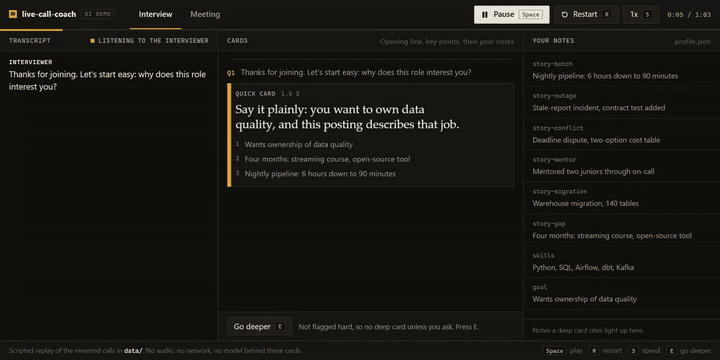

# live-call-coach

A live coach for two kinds of calls, in one package. In `--mode interview` it listens to the other side of a job interview and shows tiered hints: a quick card with an opening line, three key points and a hard-question flag, then a deeper card grounded in your own notes. In `--mode meeting` it follows a work call and shows, for each question, what was just asked, a line you could say, key facts with their sources, and the commitments made so far (who, what, when). A stale card is dropped when a new question starts. Speech-to-text and the language model are pluggable; the demo and tests use a deterministic offline stub, so nothing here calls a paid API.



## UI demo

Open `ui/index.html` by double-clicking it. It is a static front end with no backend, no build step and no network: a scripted replay of the two invented calls in `data/`, with an Interview tab and a Meeting tab.

- **Interview.** The interviewer's lines stream in word by word. After each question, a quick card arrives 1.5 s later with an opening line, three points and the hard-question flag. A hard question also gets a deep card, which cites the notes it used (they light up on the right). Press `E` to ask for a deep card on any other question. When a new question starts before a card is ready, that card is dropped and says so.
- **Meeting.** Each question gets a card with a line to say and facts with their sources. The commitments ledger (who, what, when) fills as people promise things, and a promise that answers a request updates that row instead of adding one. The reader panel shows its one allowed click, turning on captions, and that it stays read-only.
- **Controls.** `Space` plays and pauses, `R` restarts, `S` switches between 1x and 2x, `E` goes deeper. Everything works from the keyboard, and `prefers-reduced-motion` turns the animation off. The layout works from 390 px wide up.

The replay timing is compressed (gaps between lines are shortened) but card latencies are not: they are the stub's tier latencies (1.5 s quick, 5 s deep, 2 s meeting). The card wording is written for the demo; the hard flags, stale drops, retrieved notes and commitments come from running the pipeline on the bundled transcripts. `python tools/export_ui_data.py` regenerates `ui/data.js` from `data/`, and a test checks that it is in sync.

Short promo cuts (16:9 and vertical, per mode) and ready post copy are in `docs/promo/`.

## Quick start

```
python demo.py
```

The demo replays an invented interview, then an invented meeting. For the meeting it runs the read-only reader against an offline simulator, saves the session folder, and coaches from that saved session. Run the tests with `python -m unittest discover -s tests`.

Your own transcript is a JSONL file of `{"t": seconds, "speaker": "...", "text": "..."}` lines (an extra `{"t": 82, "key": "escalate"}` line asks for the deep tier):

```
python -m live_call_coach --mode interview --transcript my_call.jsonl --html prompter.html
```

`--html` writes a page that reloads every second, for a second monitor.

### Plug in a real model (no keys shipped)

```
python -m live_call_coach --mode interview --llm ollama --model llama3.2
python -m live_call_coach --mode meeting --llm cmd --cmd "ollama run llama3.2"
```

`--llm cmd` pipes the prompt to any local command on stdin and reads the answer from stdout. Both adapters live in `live_call_coach/adapters.py`; to use another backend, add a class with `complete(prompt, tier) -> str`. Replies are parsed as JSON and fall back to plain text when a model ignores the format. With a real model, a card's latency is the measured time of the call instead of the stub's fixed 1.5 s (quick), 5 s (deep) and 2 s (meeting).

### Real audio (optional)

```
pip install faster-whisper
python -m live_call_coach --mode interview --audio call.wav
```

Transcription runs locally. It is not needed for the demo or the tests.

## Requirements

Python 3.8+, standard library only. `faster-whisper` is optional. No GPU is required.

## How it works

- `engine.py` holds both pipelines on a simulated clock. A question from the other side schedules cards at its tier latency. When the next question arrives before a card is ready, the card is not shown and a `dropped` record is emitted.
- Interview tiers: quick (opening, three points, `hard` flag from `text.is_hard`) and deep (answer plus the ids of the notes it used). Hard questions get the deep tier automatically; any other question gets it on an `escalate` key event. Your own lines are never treated as questions.
- Meeting mode extracts commitments from every utterance ("I'll send it by tomorrow", "Priya, can you share it by end of day") into a ledger and attaches it to each card.
- `knowledge.py` is a small keyword retrieval over `data/profile.json` (interview notes) or `data/meeting_facts.json` (facts with a source).
- `reader.py` is the meeting reader. It writes `events.jsonl`, `live.json` and `transcript.md` to a session folder. Its only permitted click is turning on captions: `safe_click` checks an allow-list, and a test scans the source for typing, key presses and form filling. A saved session can be replayed in place of a live call.
- `ui/` is the static UI demo (`index.html`, `style.css`, `app.js`, and `data.js` generated from `data/` by `tools/export_ui_data.py`).
- `sim.py` is the offline simulator: a fake page with partial and final captions and decoy buttons (mute, leave, chat).
- A driver for a real video-call page needs `click(name)`, `poll()` and `closed`; none is bundled.

## Results

Measured by running the code in this repository:

- 22 tests pass (`python -m unittest discover -s tests`), including the stale-card drop, the commitments ledger and the reader's allow-list.
- The bundled interview produces 8 cards and drops 1 as stale; the bundled meeting produces 5 cards and drops 1.
- The stub pipeline spends a median of about 0.04 ms per card (printed by the demo on each run). The 1.5 s, 5 s and 2 s tier latencies are simulated constants, not measurements of a real model.

## License

MIT, see [LICENSE](LICENSE).

Built with Claude Code. Write-up: https://made-by-asking.pages.dev/showcase/interview-copilot/
